# BirdNET predictions to observations

Grid2 acoustic recorders, June to July 2023, BirdNET v2.4.
Code: [`birds_analysis.qmd`](../scripts/r_code/quarto/birds_analysis.qmd). The labelled predictions are in [`birdnet_predictions_labeled.csv`](../output/birds/birdnet_predictions_labeled.csv) and the per-species thresholds in [`birdnet_species_thresholds.csv`](../output/birds/birdnet_species_thresholds.csv).

## What I did

A BirdNET confidence score is not a probability, and a 0.6 means different things for different species. So I followed Wood & Kahl (2024): for each species, a logistic regression of "was the prediction correct" on the logit of the score, fitted to the clips the ornithologist checked. Solving the fitted curve for p = 0.99 gives the score above which a prediction is an observation. Every prediction at or above its species threshold gets the species name in a new `observation` column; the rest stay empty.

The validation file is a subset of the predictions, but there is no clean key between the two (the filename carries a rounded score and a selection number that is not unique), so I did not join them. The model is per species and each prediction inherits its species' curve.

A threshold is only used if the model behind it holds up. I do not use it when the validations are all correct or all wrong (nothing to fit), when the slope is not positive, or when 0.99 is only reached above the highest validated score. With fewer than five false positives the threshold is kept but the observations are marked provisional, because the curve is then placed by one or two clips. The five is a QC rule I chose, not a statistical bound. Every prediction carries a `decision_status` that says which of these applied.

## The data in one table

| | |
|---|---|
| Predictions | 29,491 for four species |
| Validated clips | 551: 422 correct, 129 wrong |
| Validations per species | 150, except Red-billed Firefinch with 101 |
| Validated score range | 0.10 to 1.0 for every species |

The validated scores cover the whole range evenly, so they were sampled by score, not at random. That is the right design for fitting the curve, but it means the share of correct clips in the validation set says nothing about the precision of the species overall.

## What I found

| Species | Correct / wrong | Threshold | Status | Observations |
|:--|--:|--:|:--|--:|
| Abyssinian Nightjar | 117 / 33 | 0.667 | calibrated | 3,147 of 10,187 |
| African Black-headed Oriole | 150 / 0 | none | no false positives | 0 of 18,054 |
| Red-billed Firefinch | 6 / 95 | 0.998, above data | extrapolated | 0 of 235 |
| Three-banded Plover | 149 / 1 | 0.259 | provisional | 538 of 1,015 |



**Only the Nightjar gives a real curve.** Its 33 false positives sit at low scores and the transition to correct predictions is clean. 74 validated clips lie above the 0.667 threshold and none of them is wrong, so the 99% claim is backed by data on both sides of the cutoff.

**The Oriole is the big decision.** It is 61% of the file and every one of its 150 validations was correct, so there is nothing to fit. The easy answer would be to accept everything. I did not, because 150 out of 150 only guarantees a precision of about 0.976 at 95% confidence, which is below the 0.99 we are claiming; it takes about 300 clean validations to get there. I left the species unlabelled and would validate another 150 clips, this time weighted towards low scores, which is where the first mistakes will show up. If the project cannot wait, the honest fallback is a provisional threshold at the lowest validated score (0.104), labelled as such.

**The Plover threshold is one clip.** A single false positive at 0.264 among 150 validations. The fitted slope is not distinguishable from zero and the threshold lands just above that clip, so 0.259 should not be read as a 99% cutoff. Its 538 observations are kept for review but excluded from the production column. A handful more false positives in the validation set would settle it either way.

**The Firefinch is a BirdNET problem, not a threshold problem.** Six correct out of 101, and the curve only reaches 0.99 at a score the validation set never saw. I would not release a threshold the model has no data for. This species needs a different route: manual review or another detector.

In total 3,147 accepted observations and 538 provisional ones out of 29,491 predictions. That is conservative on purpose. A 99% rule applied honestly to 150 validations per species does not leave much, and the useful output is knowing which species need more validation effort and how much.

## For the Tech team

Two jobs, not one. A **calibration job** runs whenever the validation table changes: per species and BirdNET version, fit `glm(outcome ~ qlogis(confidence), family = binomial)`, solve for 0.99, apply the rules above, and upsert a row into a `species_thresholds` table with `species, birdnet_version, n_validations, n_correct, n_incorrect, intercept, slope, threshold_99, max_validated_score, calibration_status, fitted_at`. The CSV in `output/birds` is what that table looks like today.

A **labelling job** runs on every upload and is plain SQL: join the predictions to `species_thresholds` on species and version, set `observation = species` where the status is calibrated or provisional and `confidence >= threshold_99`, otherwise null, and write `decision_status`. A species with no row in the table gets `not_validated`; it should not break the run.

Three things to keep explicit in the implementation. The logit transform assumes BirdNET's default sensitivity of 1; if a project changes it, divide the logit by it. Thresholds belong to a BirdNET version and to the conditions of the validation set (site, season, recorder), so a new version or a new region means a new validation round. And the two parameters, 0.99 and the five false positives, should be configuration, not code.

For the dashboard: the species table above, the calibration figure per species, and a list of species that are not yet calibrated with the number of validations they still need. That is what tells the ornithologist where to spend time.

Things to agree with the Biometrics team: the five-false-positive rule, whether the Oriole gets the provisional fallback or waits for more validations, and sampling the next validation batch by score band so the low end is covered.

## Reproduce

```
quarto render scripts/r_code/quarto/birds_analysis.qmd
```

Writes the HTML, the three CSVs in `output/birds` and the figure in `reports/figures`. R 4.5 with tidyverse, janitor and here.
