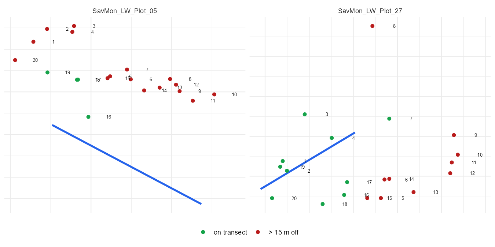
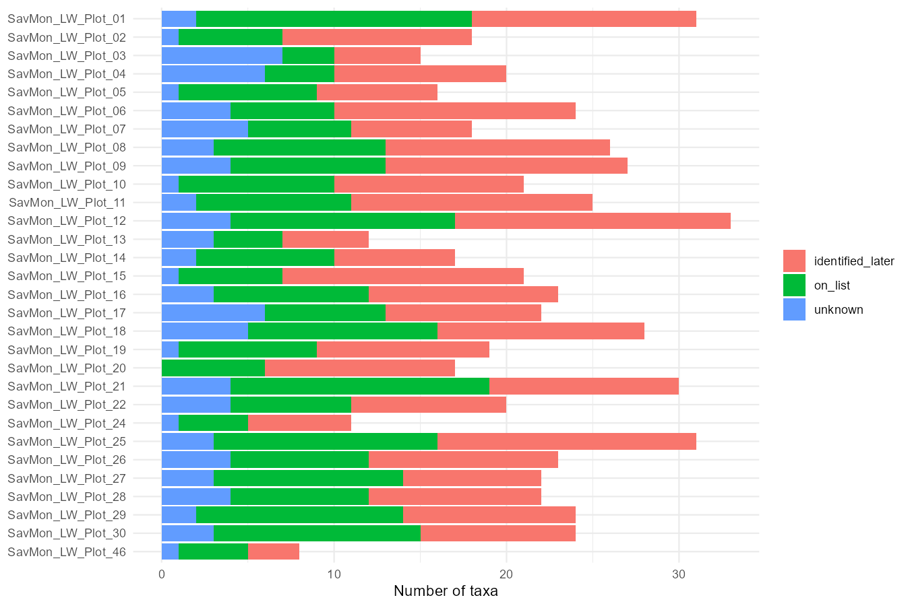
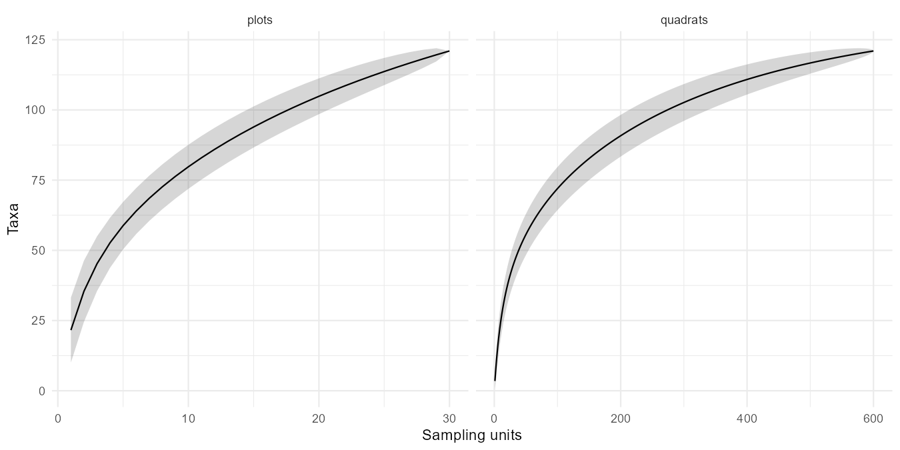
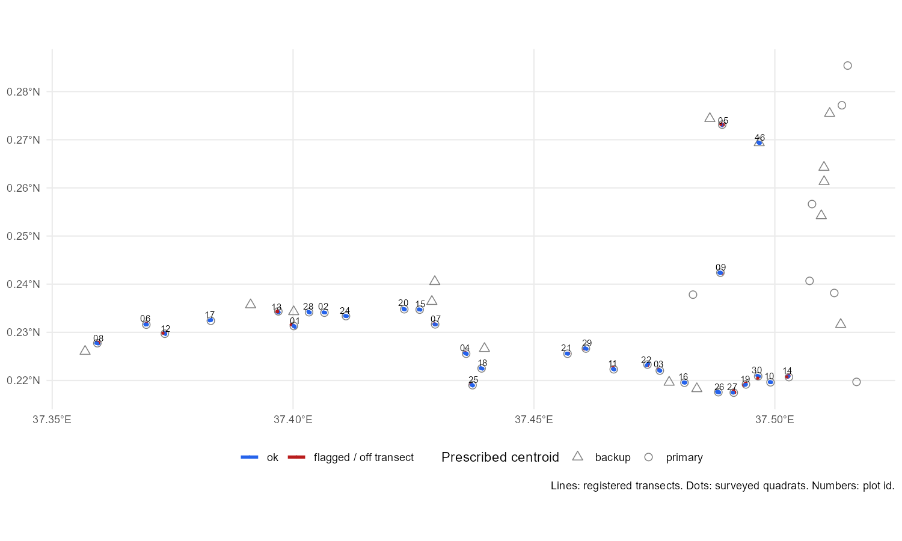

# Herbaceous vegetation survey: data quality report

SAVMON pilot, Lewa, baseline May 2026.
Code: [`vegetation_qaqc.qmd`](../scripts/quarto/vegetation_qaqc.qmd). The rendered HTML has the full tables and an interactive map; every flag is in [`herb_qaqc_flags.csv`](../output/vegetation/herb_qaqc_flags.csv).

## What I did

I joined the ODK exports into four tables (surveys, quadrats, observations, transects) and ran a set of checks on them. Each check is a one-line filter that adds rows to a single `flags` table with a level, a severity and the record it points to. Nothing in the data is corrected; the two submissions rejected in ODK Central are listed but left out of the summaries.

Species names come from the entity lists, not from text matching. A species picked from the project list is a `species` uuid. Anything typed in the field goes to `species_extra` as a `herb_NNN` code, and `species_extra_ids` holds the identification made later. If a code is still "Unknown" I keep the code as the name, so it still counts as a taxon.

Thresholds are the SOP ones: 20 quadrats per plot, a 50 m transect (I accept 40 to 60), GPS accuracy of 5 m, midpoint within 25 m of the prescribed centroid. For quadrats I flag anything more than 15 m from the A-B line, which is the 2.5 m belt plus a generous GPS error.

## The data in one table

| | |
|---|---|
| Submissions | 32, of which 2 rejected (duplicates of plots 18 and 21) |
| Valid plots | 30, all with 20 quadrats |
| Quadrats with herbs | 593 of 600 |
| Taxa | 121: 28 on the project list, 67 identified later, 28 still unknown codes |

## What I found

**The design is six plots short.** Of 36 primary plots, 29 were surveyed. Plot_23 was non-viable (private property) and was replaced by backup Plot_46, which is what the SOP says to do. Plots 31 to 36 were never registered.

**Two transects are half the prescribed length** (Plot_19, 23 m; Plot_27, 29 m). Four others are 60 to 66 m, which I would put down to GPS error at both ends. Plot_14's midpoint is 34 m from its centroid, over the 25 m limit.

**Two plots have their quadrats in the wrong place.** 65 quadrats (11%) are more than 15 m from the registered line. Most of them are in Plot_05 and Plot_27:

| Plot | Quadrats > 15 m off | Median offset |
|:--|--:|--:|
| Plot_05 | 16 | 22 m |
| Plot_27 | 10 | 14 m |
| Plot_13 | 6 | 12 m |
| Plot_19 | 6 | 8 m |



In Plot_05 the quadrats form a clean line, just 20 to 25 m away from the transect that was registered. Either the survey was laid out somewhere else or the registration is wrong. In Plot_27 they scatter around a line that is too short anyway. I would not use either plot until the field team says what happened.

**The species list is the real problem.** Only 28 of 121 taxa were on the project list, and 58% of all records went through the free-text route. That route produced:

- seven "new" species that were already on the list (*Chloris virgata*, *Cenchrus ciliaris*, *Ocimum americanum* and four more);
- seven species entered under two to four different codes, 16 codes in all (*Ipomea dichroa* alone has four);
- six codes that the curator notes mark as duplicates of other codes or as woody plants to exclude;
- five misspelt names, one of them in the identification list itself (*Hibiscuc sidiformis*);
- no name at all in the `Genus_species` format the SOP asks for. The form only blocks `, ; ( )`.

Updating the project list with the 67 identified species before the next campaign would remove most of this. Until the duplicate codes are merged, richness in this report is an upper bound.

**Minor things.** Seven quadrats have the same species twice, one species row is empty, seven comments are just punctuation. The form's own "quadrats with species" count is low in 23 of 32 submissions; its XPath rule gives the right answer when I recompute it, so it is evaluated too early in the form, not a field mistake.

Survey durations (33 to 236 min) and GPS accuracy gave no reason for concern.

## Richness and effort



Richness per plot runs from 8 (Plot_46) to 33 (Plot_12). In most plots more than half the taxa came from the free-text route.



Chao estimates about 162 ± 17 taxa against 121 observed, so three quarters of the pool was captured. The curve over quadrats flattens long before 600; the curve over plots does not. More plots would add species, more quadrats per plot would not, which is another reason to finish the six missing ones.

## Map



Circles and triangles are the prescribed primary and backup centroids. The circles without a transect in the east are plots 31 to 36. Red marks flagged transects and quadrats off their line. The HTML version has this on satellite imagery with a tooltip per quadrat.

## For the Tech team

Inputs are the four ODK exports plus the entity lists `species`, `species_extra`, `species_extra_ids`, `centroids` and `project_team`. All joins use `KEY`/`PARENT_KEY` and entity uuids. The four tables above map directly to views; species resolve as `uuid -> species_extra.unknown_index -> species_extra_ids.species_name`, so a new identification list updates the observations without touching raw data. The checks are 22 filters with their thresholds in one table; their output is the `flags` table, keyed on submission and re-run on each new one. The dashboard is flag counts by check, the two summary tables and the map.

Two things in the form are worth fixing upstream. The `quadrats_with_species` calculate should be recomputed server-side. And new species are assigned to the n-th free placeholder in `species_extra` as the device sees it, so two devices working offline on the same day can claim the same uuid for different species; assigning it server-side would close that.

Things I would want to agree with the Biometrics team: the 15 m tolerance, whether "duplicate of" codes get merged before computing richness, and what to do with plots 05 and 27.

## Reproduce

```
quarto render scripts/quarto/vegetation_qaqc.qmd
Rscript scripts/export_report_figures.R   # figures for this file
```

R 4.5 with tidyverse, janitor, here, sf, leaflet, vegan and DT.
